# AuthService · AuthVolt

[](https://github.com/lodhiPlayBits/AuthService/actions/workflows/ecr-push.yml)
[](https://github.com/lodhiPlayBits/AuthService/releases/latest)
[](LICENSE)

**Production-oriented authentication, authorization and real-time notification platform built with Spring Boot 4, PostgreSQL, Redis, Kafka and an OpenResty/Nginx gateway.**

AuthVolt provides secure user authentication: JWT access tokens, refresh-token rotation with token-family revocation, Google sign-in, role-based access control with fine-grained permissions, and gateway-level request protection. A separate notification service streams account events and admin announcements to users in real time over Kafka, Server-Sent Events and STOMP/WebSocket.

The system is built backend-first, with security, database safety, observability, rate limiting and automated production deployment in mind.

**Live:** [authvolt.fun](https://authvolt.fun) · **Changelog:** [CHANGELOG.md](CHANGELOG.md)

---

## Contents

- [Features](#features)
- [Architecture](#architecture): runtime, CI/CD, design decisions, gateway, services, Kafka, data model
- [Authentication flows](#authentication-flows): login, authorization, refresh, logout, Google
- [Real-time notifications](#real-time-notifications): SSE, account events, WebSocket, announcements
- [Tech stack](#tech-stack) · [Project structure](#project-structure) · [API endpoints](#api-endpoints)
- [Environment](#environment-configuration) · [Running locally](#running-locally) · [Testing](#testing)
- [Deployment](#deployment) · [Security](#security-considerations) · [Roadmap](#future-improvements)

---

## Features

### Authentication

* JWT access tokens (HS512, issuer and audience validated)
* Short-lived access tokens, long-lived refresh tokens in `HttpOnly` cookies scoped to `/api/v1/auth`
* Refresh-token rotation with an atomic "revoke if still active" update
* Refresh-token reuse detection and token-family revocation
* Refresh tokens stored as SHA-256 hashes, never in plain text
* CSRF double-submit protection on cookie endpoints (`XSRF-TOKEN` cookie + `X-XSRF-TOKEN` header)
* Login with **email, username or phone number**
* Google sign-in with a profile-completion step and no silent account linking
* Logout and logout-all-devices, with the current access token blacklisted in Redis
* BCrypt on virtual threads behind a semaphore, so login bursts can't starve the CPU

### Authorization / RBAC

* Roles and fine-grained permissions stored in the database and editable at runtime
* Roles and permissions carried in the access token, so there's no database lookup per request
* `@PreAuthorize` with **ownership rules** on user endpoints
* Custom `@RequiresPermission` aspect on admin endpoints
* Assign or revoke permissions on roles, assign roles to users, enable or disable accounts
* Audit log of every security-relevant event

### Real-time notifications

* Account events published to **Kafka**, keyed by user ID so each user's events stay in order
* Pushed to every open browser tab over **Server-Sent Events**
* Every event is also kept in **Redis** (last 50, 7 days) and replayed when a client reconnects with `Last-Event-ID`
* Revoked, disabled or deleted users have their SSE streams and WebSocket sessions closed by the server
* Admin announcements over **STOMP/WebSocket**, fanned out to every service instance through Kafka, with ack and dismiss
* JWT-authenticated WebSocket handshake, admin-only topics, and expired sessions closed every minute
* Retries and dead-letter topics for events that keep failing

### Gateway security

* TLS termination with HTTP → HTTPS redirect, Let's Encrypt certificates renewed by `certbot`
* Security headers: HSTS, `X-Frame-Options`, `X-Content-Type-Options`, `Referrer-Policy`, `Permissions-Policy`
* Per-route rate limiting: 3 r/s for login, register and refresh, and 10 r/s for everything else
* 20 connections per IP
* Lua request validation (CORS, request ID, `Content-Type`, `Bearer` presence) before requests reach the JVM
* Self-signed certificate fallback for local development

### Observability

* `X-Request-ID` added at the gateway, written to every log line, and carried through Kafka headers into notification-service
* Structured request logging, Actuator health probes, and an audit log table
* Kafka UI and a Prometheus Kafka exporter

### CI/CD & DevSecOps

* Tests, JaCoCo, Trivy filesystem and image scans, and SonarCloud on every PR
* Only changed services are rebuilt. Images are tagged by commit SHA in Amazon ECR.
* Deploy on merge to `main` via AWS SSM, with health checks, two layers of smoke tests and **automatic rollback**

---

# Architecture

## Runtime

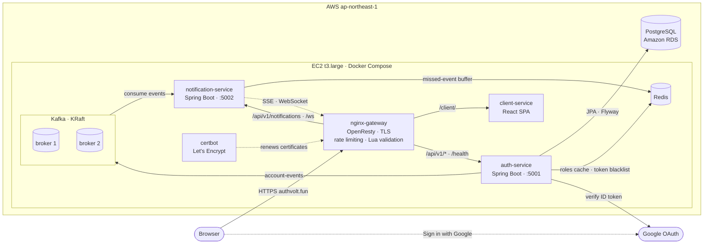

## CI/CD

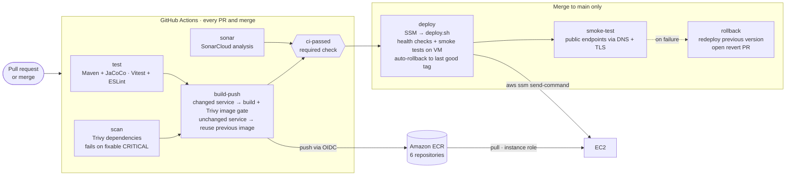

## Design decisions

| Decision | Why |
|---|---|
| GitHub OIDC → IAM role | No long-lived AWS keys stored in GitHub; trust limited to `main` and `develop` |
| AWS SSM instead of SSH | No open port 22, no SSH keys in CI |
| Reuse unchanged images | App-only changes don't rebuild or restart Kafka and Redis |
| Health checks + smoke tests before marking a deploy good | A running container isn't proof the service works; failure rolls back automatically |
| Revert PR instead of auto-revert | Branch protection stays intact; a human decides whether the code was at fault |
| Docker Compose instead of Kubernetes | Single node: Kubernetes adds cost and complexity with no benefit at this scale |
| Kafka between auth and notification services | auth-service never waits on notification delivery, and events survive a notification-service restart |
| Account status events sent after the DB commit | A rolled-back enable or disable never logs a user out |
| Atomic "revoke if active" update on refresh | Two concurrent refreshes with the same token can't both succeed; the loser is treated as reuse |
| One Kafka consumer group per instance for announcements | Every instance gets every announcement, so users connected to any instance receive it |
| HS512 shared secret for JWTs | Both services verify tokens locally with no call to auth-service; asymmetric keys are on the roadmap |

## Gateway request routing

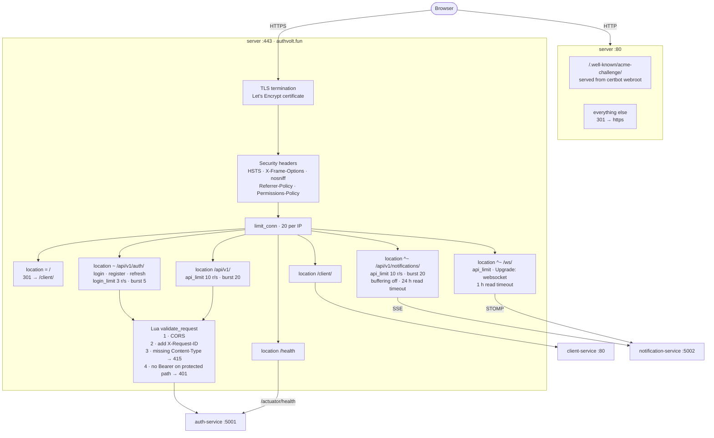

Request bodies are capped at 10 MB by `client_max_body_size`.

## auth-service internals

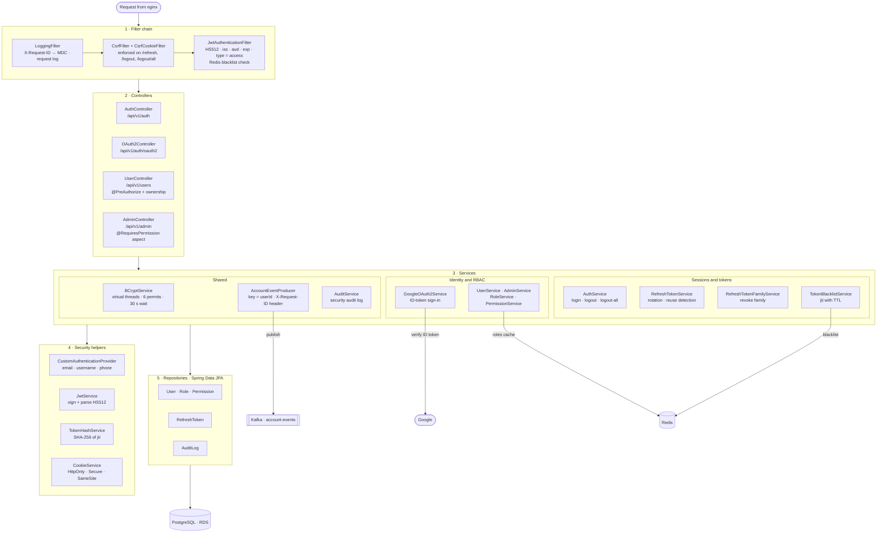

## notification-service internals

### SSE side

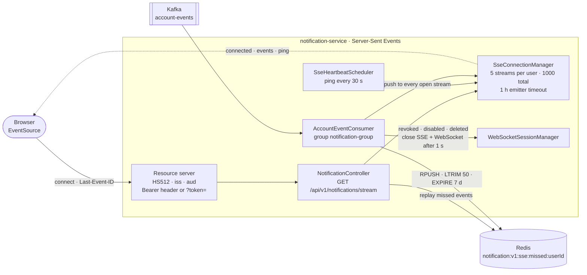

### WebSocket side

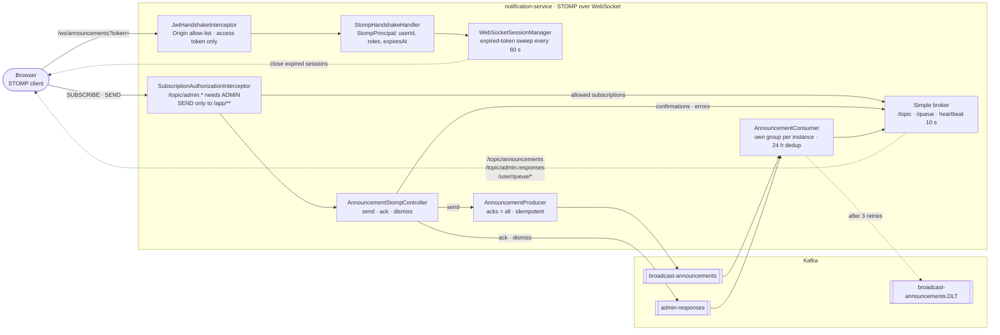

## Kafka topology

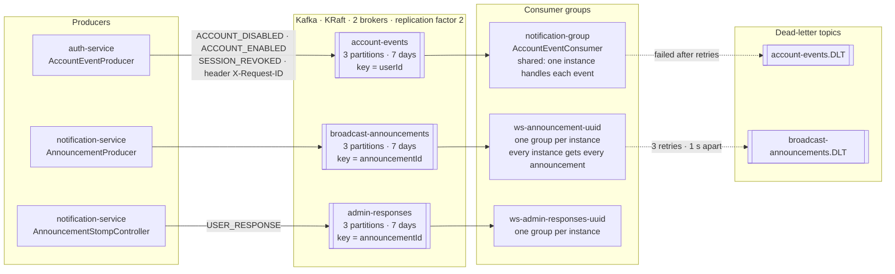

The `AccountEvent` contract also defines `ACCOUNT_DELETED`, `PASSWORD_CHANGED` and `ROLE_CHANGED`. notification-service already handles them, but auth-service doesn't publish them yet.

## Data model

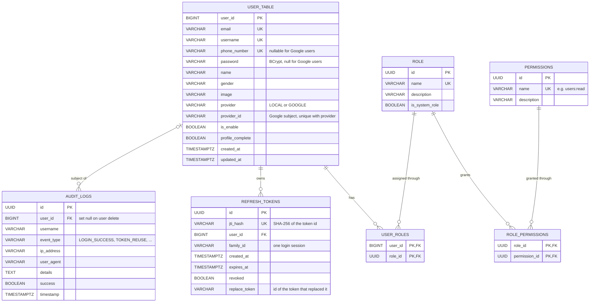

The schema is created by Flyway migrations `V1` to `V14`. Hibernate only validates it (`ddl-auto: none`).

---

# Authentication flows

## Login

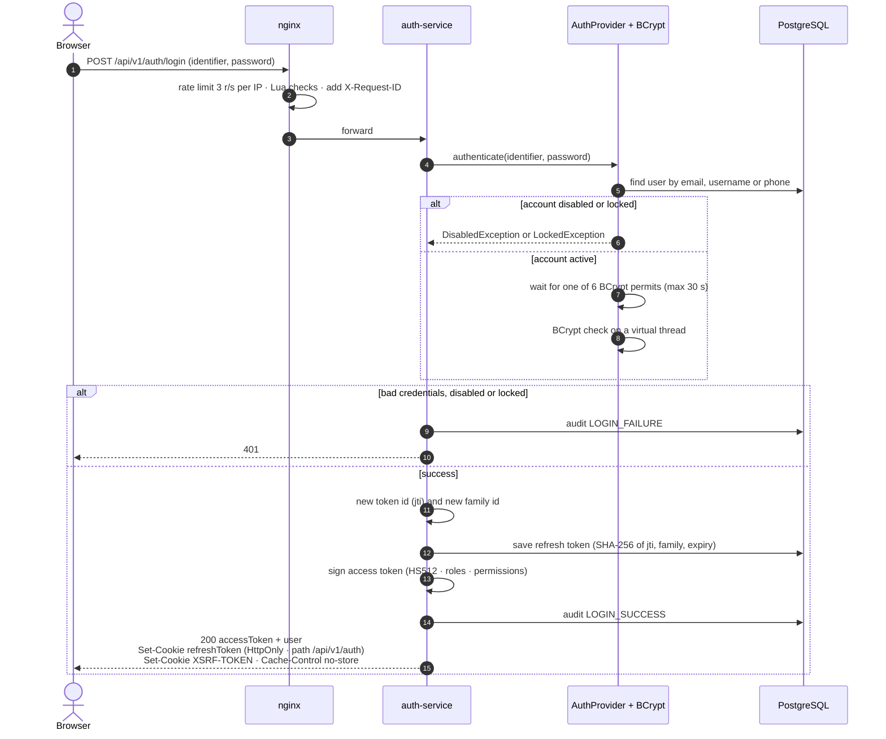

## Authorizing a request

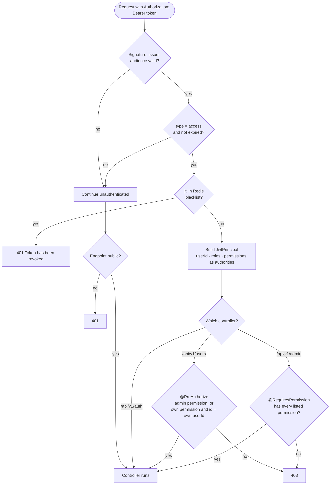

## Refresh token rotation and reuse detection

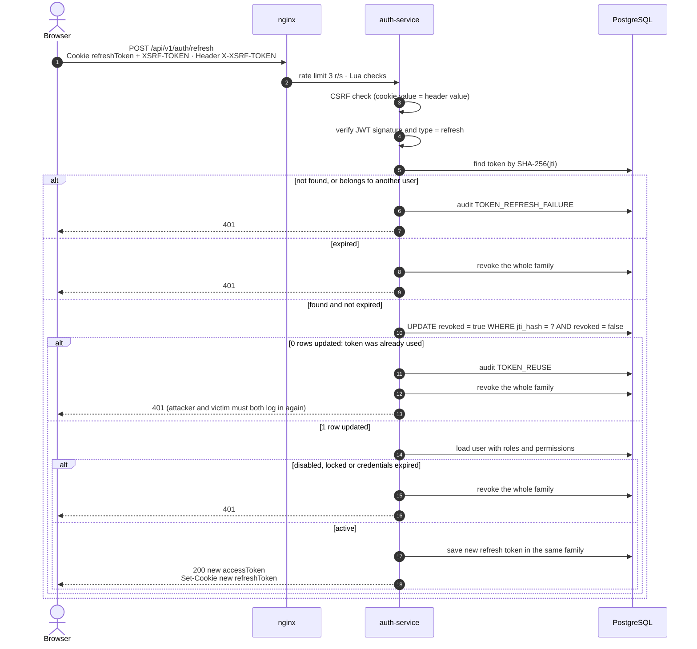

## Logout and logout from all devices

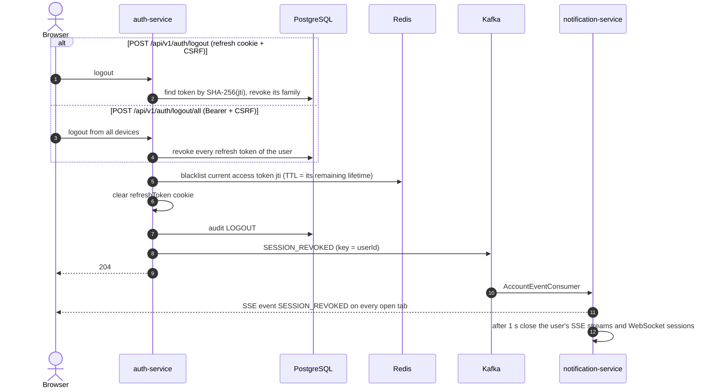

## Google sign-in

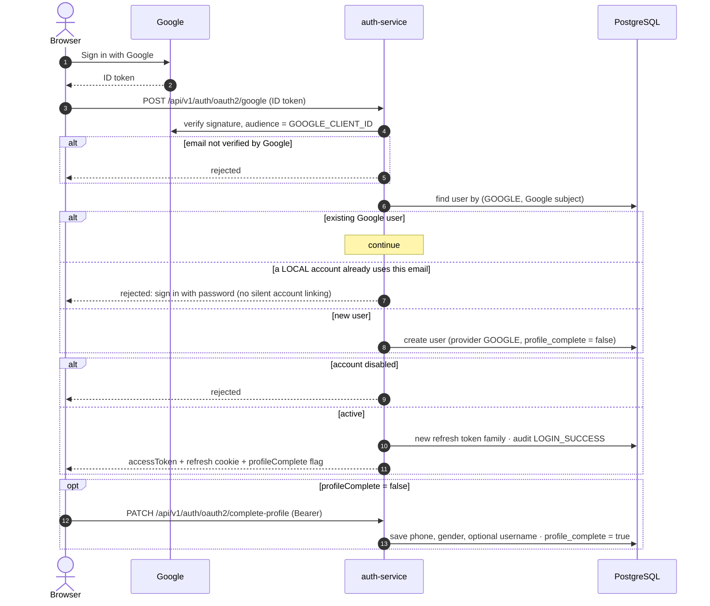

---

# Real-time notifications

## SSE connection

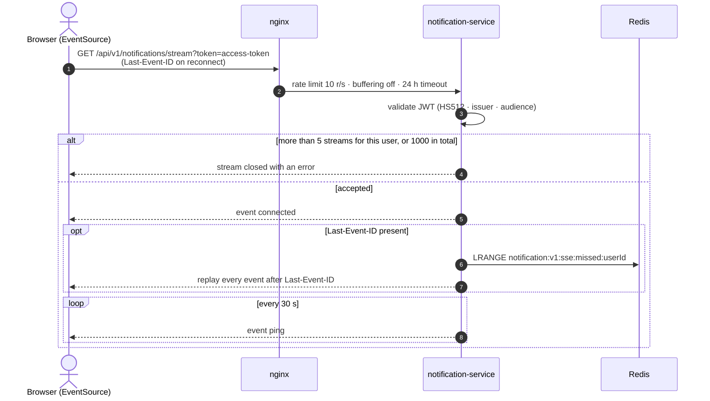

## Account event pipeline

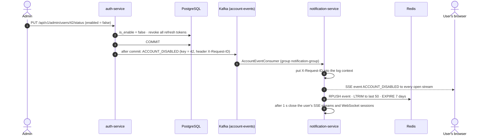

## WebSocket session lifecycle

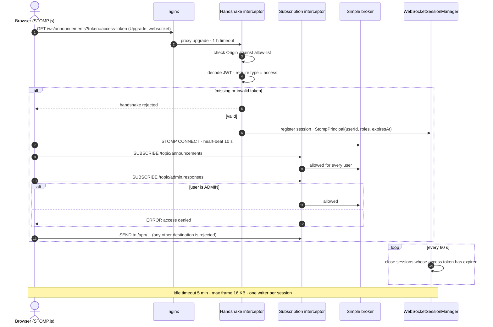

## Admin announcements

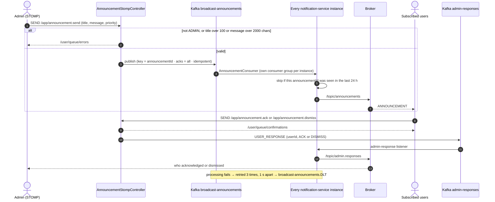

---

# RBAC

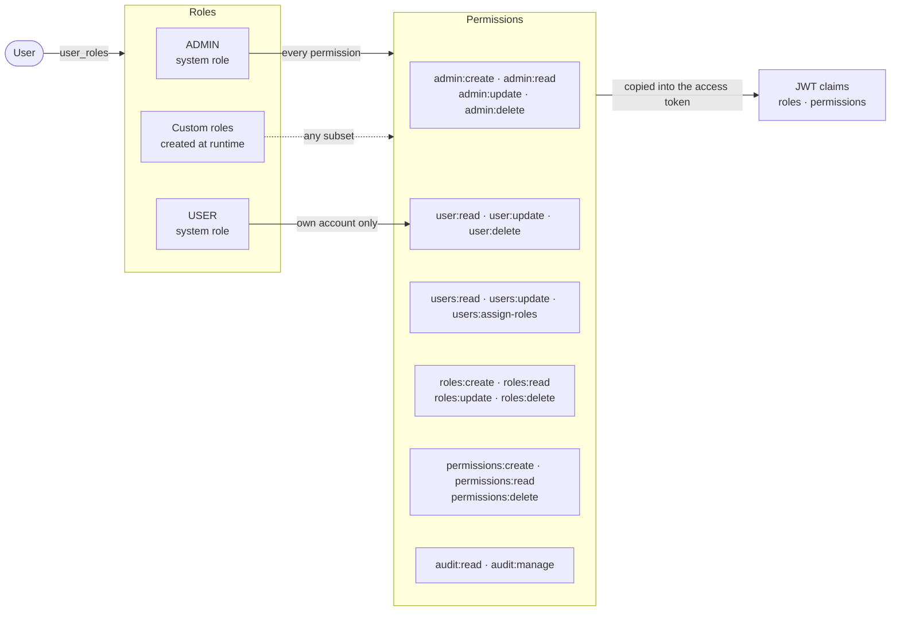

User endpoints combine a permission with an ownership rule:

```java
@PutMapping("/{id}")
@PreAuthorize("hasAuthority('admin:update') or " +
              "(hasAuthority('user:update') and #id == authentication.principal.userId)")
public ResponseEntity<UserResponseDTO> updateUser(@PathVariable Long id, ...) { ... }
```

Admin endpoints use a custom aspect:

```java
@GetMapping("/users")
@RequiresPermission("users:read")
public ResponseEntity<PagedResponse<CreateUserResponseDTO>> getAllUsers(...) { ... }
```

Role lookups are cached in Redis (`auth:roles::*`) and evicted whenever a role or its permissions change. Permission changes take effect on the user's next token refresh.

---

# Tech stack

| Area | Technology |
|---|---|
| Backend | Java 21 (virtual threads), Spring Boot 4.1, Spring Security, Spring Data JPA / Hibernate, Spring Kafka, Spring WebSocket (STOMP), Maven |
| Database & cache | PostgreSQL (Amazon RDS), HikariCP, Flyway, Redis |
| Messaging | Apache Kafka (KRaft, 2 nodes), Kafka UI, Prometheus Kafka exporter |
| Security | JJWT (HS512), BCrypt, HTTP-only cookies + CSRF, Google OAuth2, RBAC |
| Gateway | OpenResty, Nginx, Lua, Let's Encrypt |
| Frontend | React 19, Vite, React Router, STOMP.js |
| Infrastructure | Docker, Docker Compose, AWS EC2, Amazon RDS, Amazon ECR, AWS SSM |
| CI/CD & quality | GitHub Actions, JaCoCo, SonarCloud, Trivy |
| Testing | JUnit 5, Spring Boot Test, H2 integration tests, Vitest + Testing Library, k6 |

---

# Project structure

```text
AuthService/
├── auth-service/                 # Authentication & authorization API
│   ├── src/main/java/com/lodhi/auth/
│   │   ├── audit/                # Audit events and log
│   │   ├── config/               # Security, Kafka, Redis, BCrypt executor
│   │   ├── controllers/          # Auth, OAuth2, User, Admin
│   │   ├── filters/              # LoggingFilter
│   │   ├── security/             # JWT, cookies, @RequiresPermission
│   │   ├── services/             # Business logic
│   │   └── respositories/        # Spring Data repositories
│   ├── src/main/resources/
│   │   ├── application.yml
│   │   └── db/migration/         # Flyway V1–V14
│   ├── Dockerfile · docker-compose.yml · .env.example
├── notification-service/         # Kafka consumers, SSE + STOMP push
├── notification-contract/        # Shared Kafka event classes
├── client/                       # React + Vite frontend
├── nginx/                        # OpenResty gateway: conf.d/, lua/, ssl/
├── kafka/                        # 2-node KRaft cluster, UI, exporter
├── redis/                        # Redis config and persistence
├── loadtest/                     # k6 scripts and results
├── .github/
│   ├── workflows/ecr-push.yml    # CI/CD pipeline
│   └── scripts/                  # SSM runner + public smoke test
├── CHANGELOG.md
└── README.md
```

---

# API endpoints

## Authentication: `/api/v1/auth`

| Method | Endpoint | Description | Authentication |
| ------ | -------- | ----------- | -------------- |
| `POST` | `/register` | Register user | Public |
| `POST` | `/login` | Login with email, username or phone | Public |
| `POST` | `/refresh` | Rotate refresh token | Refresh cookie + `X-XSRF-TOKEN` |
| `POST` | `/logout` | Revoke current session | Refresh cookie + `X-XSRF-TOKEN` |
| `POST` | `/logout/all` | Revoke all user sessions | Bearer + `X-XSRF-TOKEN` |
| `POST` | `/oauth2/google` | Sign in with Google | Public |
| `PATCH` | `/oauth2/complete-profile` | Finish Google sign-up | Bearer |

## Users: `/api/v1/users`

| Method | Endpoint | Description | Authorization |
| ------ | -------- | ----------- | ------------- |
| `POST` | `/create-user` | Create user | `admin:create` |
| `GET` | `/getByEmail` | Find user by email | `admin:read` / `user:read` |
| `GET` | `/{id}` | Get user | `admin:read` or owner |
| `PUT` | `/{id}` | Update user | `admin:update` or owner |
| `DELETE` | `/{id}` | Delete user | `admin:delete` or owner |
| `POST` | `/{id}/change-password` | Change password | Owner only |

## Administration: `/api/v1/admin`

| Method | Endpoint | Description | Permission |
| ------ | -------- | ----------- | ---------- |
| `GET` | `/roles` | List roles | `roles:read` |
| `POST` | `/roles` | Create role | `roles:create` |
| `DELETE` | `/roles/{roleId}` | Delete role | `roles:delete` |
| `POST` | `/roles/{roleId}/permissions` | Assign permissions | `roles:update` |
| `DELETE` | `/roles/{roleId}/permissions` | Revoke permissions | `roles:update` |
| `GET` | `/permissions` | List permissions | `permissions:read` |
| `POST` | `/permissions` | Create permission | `permissions:create` |
| `DELETE` | `/permissions/{permissionId}` | Delete permission | `permissions:delete` |
| `GET` | `/users?page=&size=&sortBy=` | List users (paginated) | `users:read` |
| `PUT` | `/users/{userId}/roles` | Assign roles | `users:assign-roles` |
| `PUT` | `/users/{userId}/status` | Enable / disable user | `users:update` |

## Notifications

| Type | Endpoint | Description |
| ---- | -------- | ----------- |
| SSE | `GET /api/v1/notifications/stream` | Live account events (`?token=` or Bearer, `Last-Event-ID` to resume) |
| WebSocket | `/ws/announcements?token=` | STOMP endpoint |
| STOMP | `SUBSCRIBE /topic/announcements` | Receive announcements |
| STOMP | `SUBSCRIBE /topic/admin.responses` | Ack and dismiss responses (admin only) |
| STOMP | `SUBSCRIBE /user/queue/confirmations` · `/user/queue/errors` | Personal confirmations and errors |
| STOMP | `SEND /app/announcement.send` | Broadcast an announcement (admin) |
| STOMP | `SEND /app/announcement.ack` · `/app/announcement.dismiss` | Acknowledge or dismiss |

---

# Environment configuration

Copy the example file. notification-service reads the same file, so both services share the JWT secret, issuer and audience.

```bash
cp auth-service/.env.example auth-service/.env
```

Never commit `.env` or any file containing real secrets.

| Group | Variables |
|---|---|
| Database | `DB_HOST` `DB_PORT` `DB_NAME` `DB_USERNAME` `DB_PASSWORD` |
| Admin bootstrap | `ADMIN_EMAIL` `ADMIN_USERNAME` `ADMIN_PASSWORD` `ADMIN_PHONE` |
| JWT | `JWT_SECRET` (≥ 64 bytes) `JWT_ISSUER` `JWT_AUDIENCE` `JWT_ACCESS_TTL_SECOND` `JWT_REFRESH_TTL_SECOND` |
| Refresh cookie | `JWT_REFRESH_TOKEN_COOKIE_NAME` `JWT_COOKIE_HTTP_ONLY` `JWT_COOKIE_SECURE` `JWT_COOKIE_SAME_SITE` `JWT_COOKIE_DOMAIN` `JWT_COOKIE_PATH` |
| Google | `GOOGLE_CLIENT_ID` |
| Redis | `REDIS_HOST` `REDIS_PORT` `REDIS_PASSWORD` `CACHE_TTL` |
| Kafka | `KAFKA_BOOTSTRAP_SERVERS` `KAFKA_TOPIC_REPLICATION_FACTOR` |
| HikariCP | `HIKARI_MAX_POOL_SIZE` `HIKARI_MIN_IDLE` `HIKARI_CONNECTION_TIMEOUT` `HIKARI_IDLE_TIMEOUT` `HIKARI_MAX_LIFETIME` `HIKARI_LEAK_DETECTION_THRESHOLD` |
| Application | `SERVER_PORT` `SERVER_CONNECTION_TIMEOUT` `QUERY_TIMEOUT` `LOCK_TIMEOUT` `BCRYPT_MAX_CONCURRENT` |
| notification-service | `CORS_ALLOWED_ORIGINS` `WEBSOCKET_ALLOWED_ORIGINS` |
| Logging / Actuator | `LOG_LEVEL_*` `LOG_FILE` `ACTUATOR_ENDPOINTS` `ACTUATOR_HEALTH_SHOW_DETAILS` |
| Frontend (build time) | `VITE_API_URL` `VITE_GOOGLE_CLIENT_ID` |
| Development only | `JPA_SHOW_SQL` `JPA_FORMAT_SQL` |

---

# Running locally

**Prerequisites:** Java 21, Maven 3.9+, Docker with Compose, Node.js 20, PostgreSQL 15+.

```bash
git clone https://github.com/lodhiPlayBits/AuthService.git
cd AuthService

# 1. Shared Docker network
docker network create authnet

# 2. Redis and Kafka (Kafka creates authvolt-kafka-network)
(cd redis && docker compose up -d)
(cd kafka && docker compose up -d)

# 3. Shared event contract (both services depend on it)
mvn -f notification-contract/pom.xml -DskipTests install

# 4. Configuration
cp auth-service/.env.example auth-service/.env     # fill in the values

# 5. Build the jars, then start the services
mvn -f auth-service/pom.xml -DskipTests package
mvn -f notification-service/pom.xml -DskipTests package
(cd auth-service && docker compose --env-file .env up -d --build)
(cd notification-service && docker compose up -d --build)

# 6. Frontend
cd client && npm ci && npm run dev
```

Flyway creates the database schema on first start. Check containers with `docker ps` and logs with `docker logs -f auth-service`.

---

# Testing

```bash
mvn -f auth-service/pom.xml clean verify          # report: auth-service/target/site/jacoco/index.html
mvn -f notification-service/pom.xml clean verify
(cd client && npm test)
```

The suites cover unit tests, Spring context tests, controller, filter and security tests, repository and integration tests (H2), and frontend component tests.

Load tests live in [`loadtest/`](loadtest). Moving BCrypt onto virtual threads behind a semaphore gave **+28% throughput, −29% p95 login latency and zero timeouts** at 40 RPS on a 2-vCPU t3.large.

---

# Deployment

## deploy.sh on the EC2 host

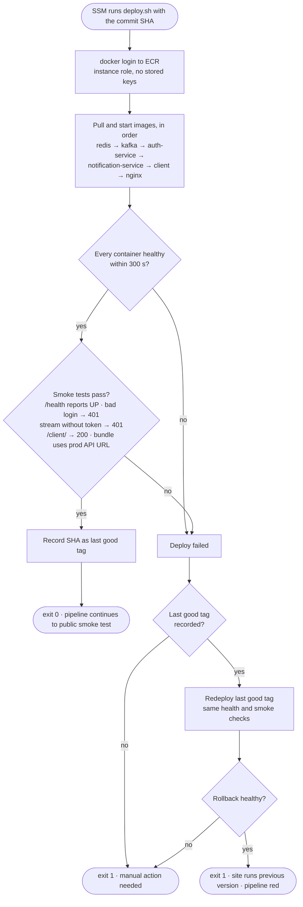

## Pipeline triggers

| Event | What runs |
| ----- | --------- |
| Pull request | Tests, scans, Sonar, image build (no push) |
| Push to `develop` | Everything above + push images to ECR |
| Push to `main` | Everything above + deploy + public smoke test (+ rollback and revert PR on failure) |

`main` and `develop` are protected, so every change goes through a pull request. Production configuration comes from environment variables. Never hardcode secrets in source code, Dockerfiles, Git history or committed configuration.

---

# Security considerations

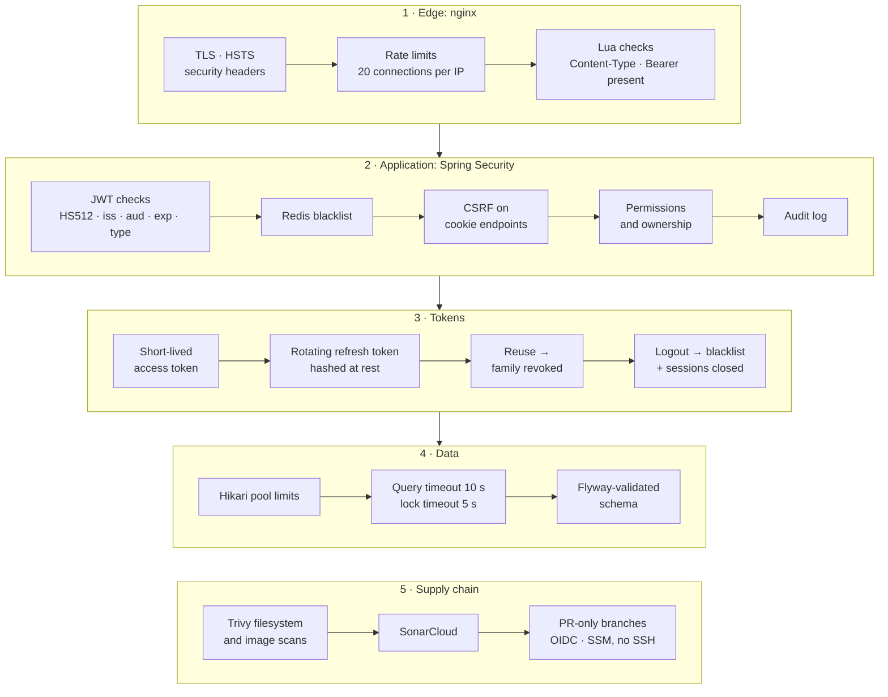

No single control is expected to protect the whole system.

---

# Design goals

* Secure authentication and fine-grained authorization
* Stateless access tokens, stateful and revocable refresh tokens
* Refresh-token compromise detection
* Defense in depth at the gateway and application layers
* Event-driven communication between services
* Real-time notifications that survive reconnects
* Production-oriented database configuration
* Traceable requests across services
* Containerized, automated deployment with safe rollback

---

# Future improvements

* Publish `ROLE_CHANGED`, `PASSWORD_CHANGED` and `ACCOUNT_DELETED` events (already in the contract)
* Email verification and password reset
* Account lockout / suspicious-login detection
* MFA / TOTP
* Redis-backed distributed rate limiting
* Distributed tracing with OpenTelemetry
* Prometheus + Grafana dashboards
* Secret management with AWS Secrets Manager
* Asymmetric JWT signing (RS256 / JWKS)

---

# Versioning

The project follows [Semantic Versioning](https://semver.org/). Releases are tagged `vX.Y.Z` on `main` and described in the [CHANGELOG](CHANGELOG.md). Commit messages follow [Conventional Commits](https://www.conventionalcommits.org/).

---

# Author

**Gaurav Lodhi**

Backend / Software Engineer focused on Java, Spring Boot, distributed systems, databases, and production backend infrastructure.

If you find the project useful, consider giving it a ⭐.

Built with **Java 21 + Spring Boot + PostgreSQL + Redis + Kafka + OpenResty** · Licensed under [MIT](LICENSE).
