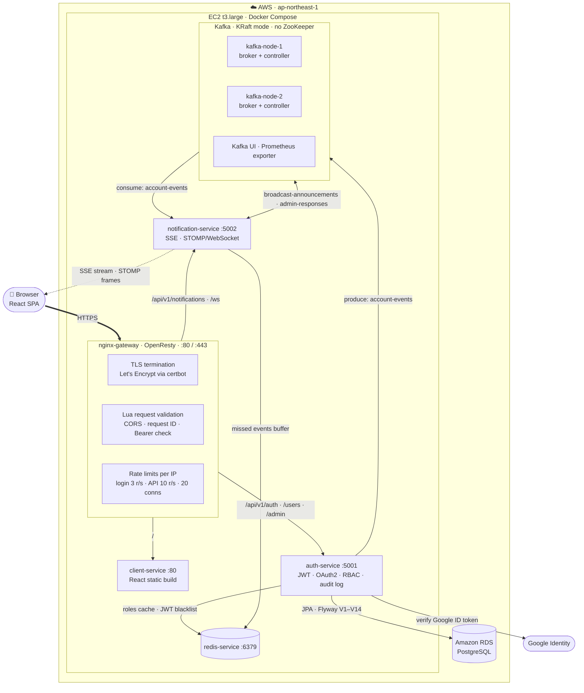
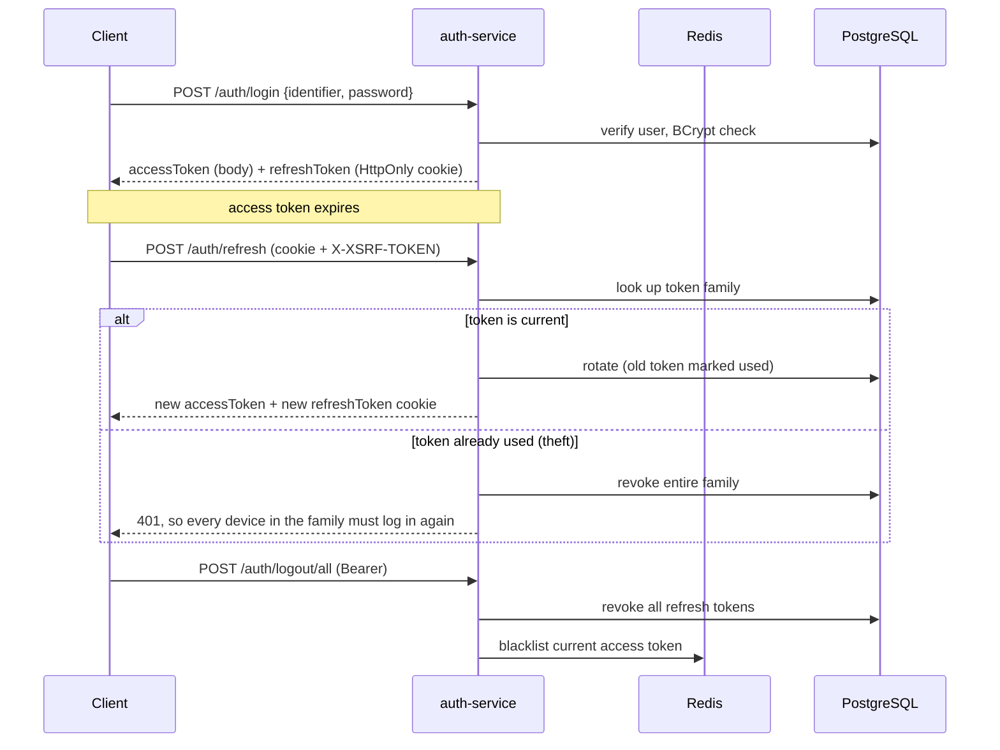
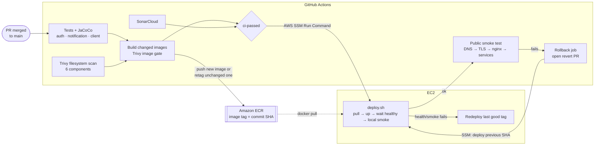

# AuthVolt

[](https://github.com/lodhiPlayBits/AuthService/actions/workflows/ecr-push.yml)
[](https://sonarcloud.io/summary/new_code?id=lodhiPlayBits_AuthService)
[](https://github.com/lodhiPlayBits/AuthService/releases/latest)
[](LICENSE)

AuthVolt is an authentication and notification platform built with Spring Boot 4 and Java 21. It covers stateless JWT access tokens, rotating refresh tokens with reuse detection, Google sign-in, database-driven RBAC, and real-time notifications over Kafka, SSE and WebSocket. It runs on AWS behind nginx, and every merge to `main` deploys automatically, with a smoke test and automatic rollback.

**Live:** [authvolt.fun](https://authvolt.fun) · **Changelog:** [CHANGELOG.md](CHANGELOG.md)

---

## Contents

- [Features](#features)
- [Architecture](#architecture)
- [How authentication works](#how-authentication-works)
- [Tech stack](#tech-stack)
- [Repository layout](#repository-layout)
- [Getting started](#getting-started)
- [API reference](#api-reference)
- [CI/CD](#cicd)
- [Performance](#performance)
- [Versioning](#versioning)

---

## Features

**Authentication**
- Log in with an email, username or phone number. The identifier type is detected automatically.
- Short-lived HS512 access tokens with required issuer and audience. Refresh tokens live in an `HttpOnly` cookie scoped to `/api/v1/auth`.
- **Refresh token rotation with token families.** Each refresh issues a new token. If an already-used token is presented again, the whole family is revoked and a `TOKEN_REUSE` audit event is recorded.
- CSRF double-submit protection on cookie-based endpoints (`XSRF-TOKEN` cookie + `X-XSRF-TOKEN` header).
- Logout from the current device or from all devices. Revoked access tokens are blacklisted in Redis until they expire.
- Google OAuth2 sign-in, with a step to complete the profile for new accounts.

**Authorization**
- Roles and permissions live in the database and can be changed at runtime (`users:read`, `roles:update`, `audit:read`, …).
- Admin endpoints are guarded by a `@RequiresPermission` aspect.
- Audit log of security events: logins, failures, token reuse, role and permission changes, and more.

**Notifications** (`notification-service`)
- `auth-service` publishes account events to Kafka (`account-events`, with a dead-letter topic).
- Users receive live updates over **SSE** (`/api/v1/notifications/stream`).
- Admin announcements go over **STOMP/WebSocket** (`/ws/announcements`) with ack and dismiss. The WebSocket handshake and every subscription are authenticated with the JWT.

**Operations**
- Database schema versioned with Flyway (14 migrations).
- Correlation IDs in every log line, structured logging via Logback, and Actuator health probes.
- BCrypt runs on virtual threads behind a concurrency limit, so a burst of logins can't starve the CPU.
- nginx (OpenResty) handles TLS (Let's Encrypt), per-IP rate limits (3 r/s for login, 10 r/s for the API) and connection limits.

---

## Architecture

### System overview



### Request path

1. **nginx** terminates TLS and applies the per-IP rate limits. A Lua script adds an `X-Request-ID` and rejects obviously bad requests (disallowed CORS origin, missing `Bearer` header on protected paths, missing `Content-Type`, oversized body) before they use a backend thread. It deliberately does **not** verify JWT signatures; Spring Security is the only component that does.
2. **auth-service** validates the JWT (signature, `iss`, `aud`, expiry, Redis blacklist), checks permissions through `@RequiresPermission`, and calls PostgreSQL. Account changes are published to Kafka after the transaction commits.
3. **notification-service** consumes those events and pushes them to the user's open SSE stream. If the user is offline, the event goes into a Redis buffer and is replayed when they reconnect.

### Containers

| Container | Port | Networks | Role |
|---|---|---|---|
| `nginx-gateway` | 80, 443 (public) | `authnet` | TLS, routing, rate limiting, Lua validation |
| `certbot` | – | `authnet` | Renews Let's Encrypt certificates |
| `client-service` | 80 | `authnet` | Serves the React build |
| `auth-service` | 5001 | `authnet`, `authvolt-kafka-network` | Auth API, RBAC, audit, event producer |
| `notification-service` | 5002 | `authnet`, `authvolt-kafka-network` | Event consumer, SSE + STOMP push |
| `redis-service` | 6379 | `authnet` | Cache, token blacklist, missed-event buffer |
| `authvolt-kafka-node-1/2` | 19092 (internal) | `authvolt-kafka-network` | 2-node KRaft cluster |
| `authvolt-kafka-ui`, `authvolt-kafka-exporter` | 8080, 9308 | `authvolt-kafka-network` | Cluster UI and metrics |

PostgreSQL runs on **Amazon RDS**, outside the VM. Only nginx publishes ports to the internet.

### Kafka topics

| Topic | Producer | Consumer | Purpose |
|---|---|---|---|
| `account-events` | auth-service | notification-service | `ACCOUNT_DISABLED`, `ACCOUNT_ENABLED`, `ACCOUNT_DELETED`, `PASSWORD_CHANGED`, `ROLE_CHANGED`, `SESSION_REVOKED` |
| `account-events.DLT` | Spring Kafka | – | Dead-letter topic for events that keep failing |
| `broadcast-announcements` | notification-service | notification-service (all instances) | Admin announcements fanned out to every connected client |
| `admin-responses` | notification-service | notification-service | Ack and dismiss responses routed back to the admin |

### Redis usage

| Owner | Key / cache | TTL | Purpose |
|---|---|---|---|
| auth-service | `auth:roles::*` | 1 h | Cached role and permission lookups, evicted on any role change |
| auth-service | token blacklist by `jti` | remaining token lifetime | Access tokens revoked by logout stop working immediately |
| notification-service | missed events per user | 7 days, last 50 | Replayed to SSE clients when they reconnect |

---

## How authentication works



---

## Tech stack

| Layer | Technology |
|---|---|
| Services | Java 21, Spring Boot 4.1 (Web MVC, Security, Data JPA, AOP, Actuator), virtual threads |
| Auth | JJWT (HS512), BCrypt, Google OAuth2 |
| Data | PostgreSQL, Flyway, Redis (cache + blacklist) |
| Messaging | Apache Kafka (KRaft, 2 nodes), Spring Kafka, SSE, STOMP over WebSocket |
| Frontend | React 19, Vite, React Router, STOMP.js, Vitest |
| Edge | nginx / OpenResty + Lua, Let's Encrypt |
| CI/CD | GitHub Actions, JaCoCo, SonarCloud, Trivy, Amazon ECR, AWS SSM, EC2 |
| Load testing | k6 |

---

## Repository layout

```
.
├── auth-service/           # Spring Boot auth API (JWT, OAuth2, RBAC, audit)
├── notification-service/   # Kafka consumer, SSE + STOMP/WebSocket push
├── notification-contract/  # Shared Kafka event types (AccountEvent, BroadcastAnnouncementEvent)
├── client/                 # React + Vite frontend
├── kafka/                  # 2-node KRaft cluster, Kafka UI, exporter
├── redis/                  # Redis with persistence config
├── nginx/                  # Reverse proxy, TLS, rate limiting
├── loadtest/               # k6 scripts and recorded runs
└── .github/                # CI/CD workflow, deploy and smoke-test scripts
```

The infrastructure folders each have their own README: [kafka](kafka/README.md) · [redis](redis/README.md) · [nginx](nginx/README.md).

---

## Getting started

### Prerequisites
Java 21, Maven 3.9+, Docker with Compose, Node 20, and a PostgreSQL database.

### 1. Start the infrastructure
```bash
(cd redis && docker compose up -d)
(cd kafka && docker compose up -d)
```

### 2. Build the shared contract
Both services depend on it.
```bash
mvn -f notification-contract/pom.xml -DskipTests install
```

### 3. Configure and run the services
Each service reads a `.env` file. The variables are listed in that service's `docker-compose.yml`. At minimum, `auth-service` needs:

| Variable | Purpose |
|---|---|
| `DB_HOST`, `DB_PORT`, `DB_NAME`, `DB_USERNAME`, `DB_PASSWORD` | PostgreSQL connection |
| `JWT_SECRET`, `JWT_ISSUER`, `JWT_AUDIENCE` | Token signing and validation |
| `REDIS_HOST`, `KAFKA_BOOTSTRAP_SERVERS` | Infrastructure endpoints |
| `ADMIN_EMAIL`, `ADMIN_USERNAME`, `ADMIN_PASSWORD` | Bootstrap admin account (**always override the defaults**) |
| `GOOGLE_CLIENT_ID` | Google sign-in |

```bash
(cd auth-service && docker compose --env-file .env up -d --build)
(cd notification-service && docker compose --env-file .env up -d --build)
```

Flyway creates the schema on first start.

### 4. Run the frontend
```bash
cd client
npm ci
npm run dev
```

### Run the tests
```bash
mvn -f auth-service/pom.xml verify          # tests + JaCoCo report in target/site/jacoco
mvn -f notification-service/pom.xml verify
(cd client && npm test)
```

---

## API reference

All routes are under `/api/v1`. "Bearer" means `Authorization: Bearer <accessToken>`.

### Auth: `/auth`
| Method | Path | Auth | Description |
|---|---|---|---|
| POST | `/auth/register` | public | Create an account |
| POST | `/auth/login` | public | Log in with email, username or phone |
| POST | `/auth/refresh` | cookie + CSRF | Rotate the refresh token and get a new access token |
| POST | `/auth/logout` | cookie | Revoke the current session's token family |
| POST | `/auth/logout/all` | Bearer | Revoke every session for the user |
| POST | `/auth/oauth2/google` | public | Sign in with a Google ID token |
| PATCH | `/auth/oauth2/complete-profile` | Bearer | Finish profile setup after Google sign-up |

### Users: `/users`
| Method | Path | Description |
|---|---|---|
| GET | `/users/{id}` | Get a user |
| PUT | `/users/{id}` | Update a profile |
| DELETE | `/users/{id}` | Delete a user |
| POST | `/users/{id}/change-password` | Change the password |

### Admin: `/admin` (Bearer + permission)
| Method | Path | Description |
|---|---|---|
| GET | `/admin/users?page=&size=&sortBy=` | List users (paginated) |
| PUT | `/admin/users/{userId}/roles` | Assign roles |
| PUT | `/admin/users/{userId}/status` | Enable or disable a user |
| GET, POST | `/admin/roles` | List or create roles |
| DELETE | `/admin/roles/{roleId}` | Delete a role |
| POST, DELETE | `/admin/roles/{roleId}/permissions` | Grant or revoke permissions |
| GET, POST | `/admin/permissions` | List or create permissions |
| DELETE | `/admin/permissions/{permissionId}` | Delete a permission |

### Notifications
| Type | Endpoint | Description |
|---|---|---|
| SSE | `GET /api/v1/notifications/stream` | Live account events for the logged-in user |
| STOMP | `/ws/announcements` | Subscribe to `/topic/announcements`. Send to `/app/announcement.send`, `.ack` or `.dismiss`. |

---

## CI/CD

Everything runs from one workflow, [`ecr-push.yml`](.github/workflows/ecr-push.yml):



There are two layers of protection. `deploy.sh` checks container health and runs a local smoke test, and redeploys the last good tag on failure. The GitHub job then tests the site from the public internet and rolls back if that fails too.

- **PRs** run tests, scans and image builds, but push and deploy nothing.
- **Pushes to `develop`** also push images to ECR.
- **Pushes to `main`** (merged PRs) also deploy to EC2. Services whose code didn't change reuse their previous image, so their containers don't restart.
- If the public smoke test fails, the VM is rolled back to the previous commit and a revert PR is opened for review. Nothing is pushed to `main` automatically.
- Builds fail on fixable CRITICAL vulnerabilities. Coverage below 70% is flagged on the PR.

`main` and `develop` are protected, so every change goes through a pull request.

---

## Performance

Load-tested with [k6](loadtest) against a single t3.large (2 vCPU). Login throughput is bound by BCrypt. Moving password checks onto virtual threads behind a concurrency limit gave **+28% throughput, −29% p95 login latency, and zero timeouts** at 40 RPS. The full analysis is in [`loadtest/runs`](loadtest/runs).

---

## Versioning

The project follows [Semantic Versioning](https://semver.org/). Releases are tagged `vX.Y.Z` on `main` and described in the [CHANGELOG](CHANGELOG.md). Commit messages follow [Conventional Commits](https://www.conventionalcommits.org/) (`feat:`, `fix:`, `chore:`, `ci:`, `docs:`).

## License

[MIT](LICENSE) © Gaurav Lodhi
